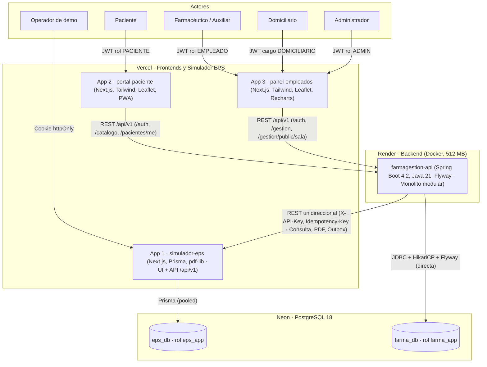
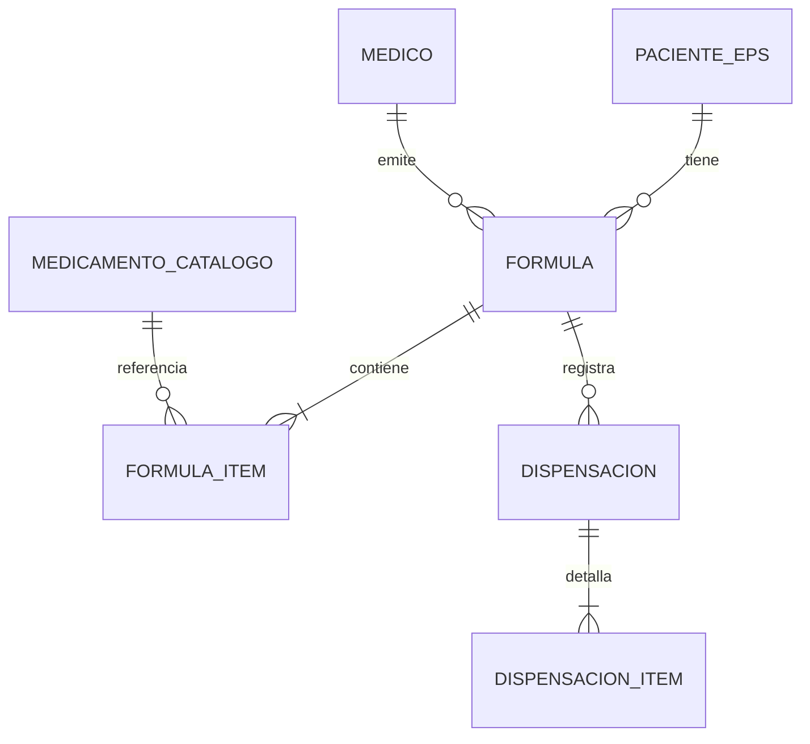
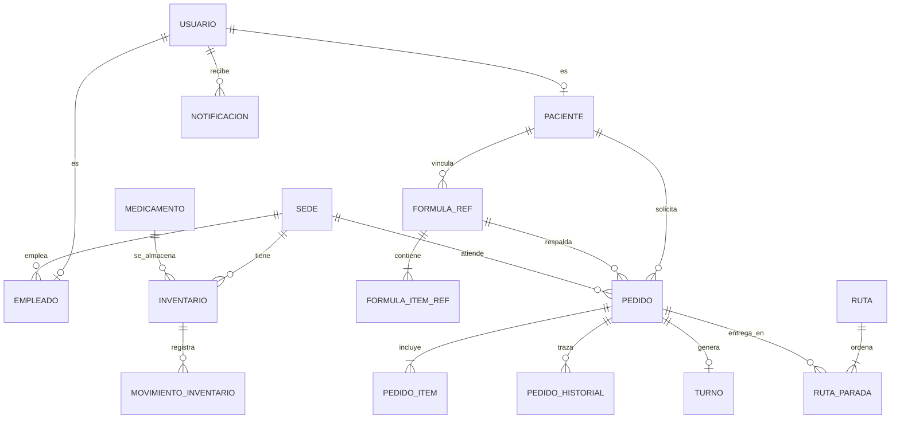
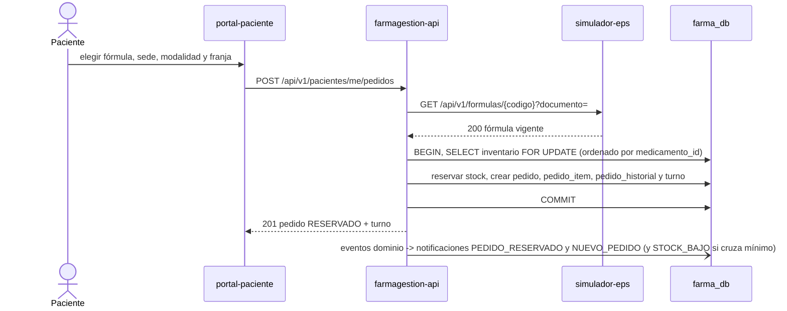
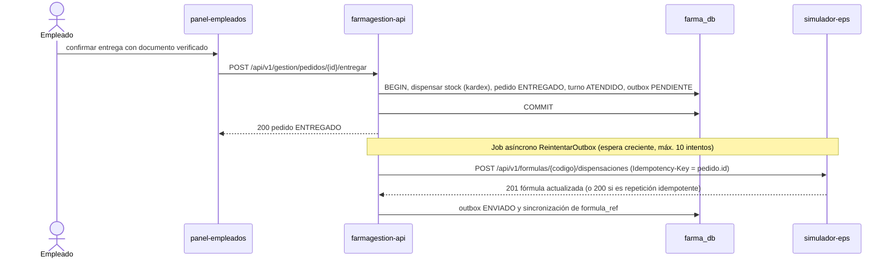
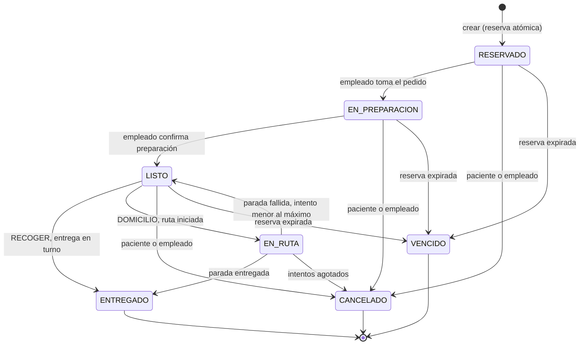
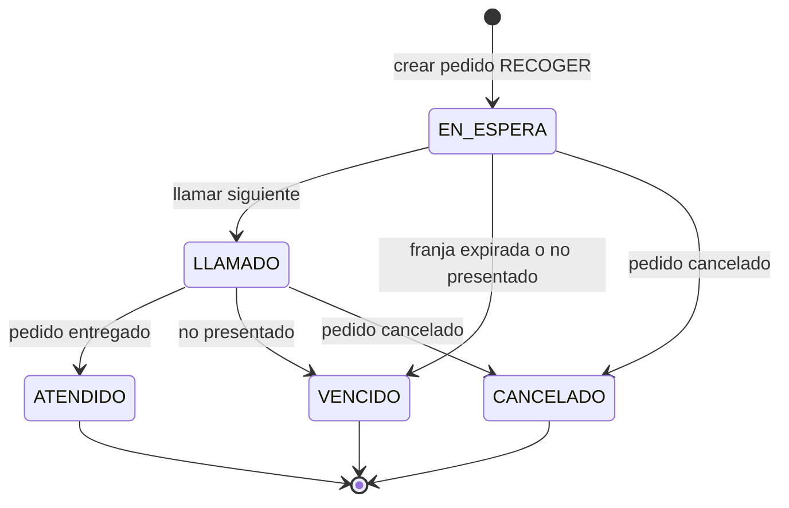
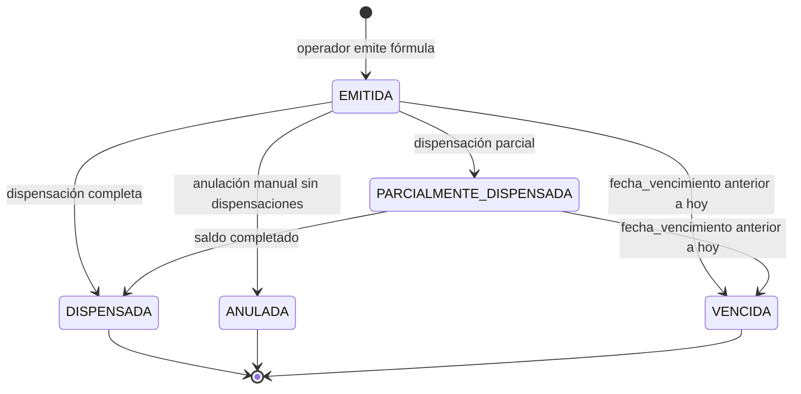
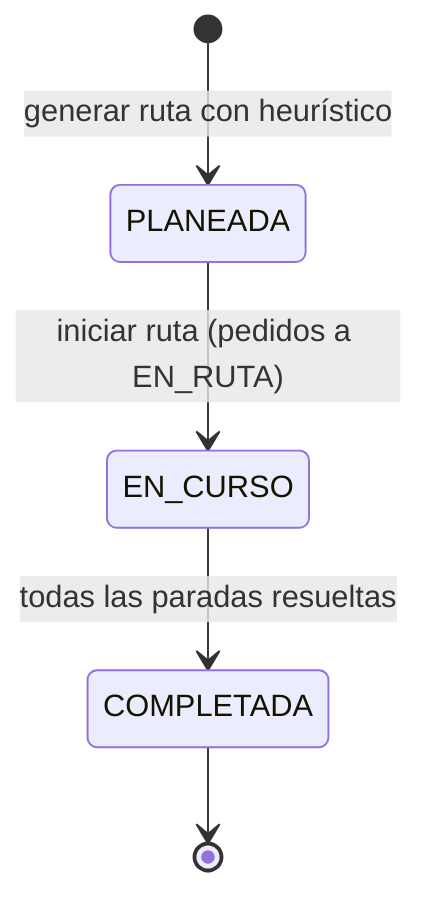

# Arquitectura — FarmaGestión

Documento de referencia arquitectónica de la simulación funcional **FarmaGestión S.A.S.**, consolidado a partir de `docs/specs/00-arquitectura-y-contratos.md` y del sistema implementado (P1–P11).

---

## 1. Relación con el portafolio

| Proyecto del portafolio | Ubicación en el sistema |
|---|---|
| **P1.** Sistema integrado de gestión y consulta de inventarios | Módulos `inventario` y `catalogo` de `farmagestion-api` |
| **P2.** Plataforma digital de consulta de medicamentos y turnos | App 2 · `portal-paciente` (`apps/portal-paciente`) |
| **P3.** Automatización de procesos internos | App 3 · `panel-empleados` (`apps/panel-empleados`) y automatizaciones del backend (`pedidos`, `turnos`, `domicilios`, `notificaciones`, `integracion`, `reportes`) |
| *(Andamiaje externo de la demo)* | App 1 · `simulador-eps` (`apps/simulador-eps`), fuera del portafolio de la organización |

---

## 2. Diagrama de contexto y arquitectura de componentes

### Reglas estructurales de arquitectura

1. **Dependencia unidireccional:** `farmagestion-api` consulta y notifica dispensaciones a `simulador-eps`; el simulador nunca llama al backend de FarmaGestión.
2. **Aislamiento de bases de datos:** cada backend es dueño exclusivo de su base (`eps_db` vs. `farma_db`) con roles independientes (`eps_app` y `farma_app`). No hay tablas compartidas ni llaves foráneas entre bases; el vínculo es únicamente lógico mediante `codigo` de medicamento (`MED-0001…MED-0030`) y `codigo` de fórmula (`FRM-YYYY-NNNNNN`).
3. **API compartida con separación por rol y namespace:** `portal-paciente` consume `/api/v1/auth`, `/api/v1/catalogo` y `/api/v1/pacientes/me/**`; `panel-empleados` consume `/api/v1/auth` y `/api/v1/gestion/**`.
4. **Monolito modular en `farmagestion-api`:** 10 módulos (`auth`, `catalogo`, `inventario`, `formulas`, `pedidos`, `turnos`, `domicilios`, `notificaciones`, `integracion`, `reportes`) comunicados por interfaces públicas, puertos y eventos de dominio de Spring (`ApplicationEventPublisher`).
5. **Contract-first y tipado:** el contrato del simulador vive en `contracts/eps-simulador.openapi.yaml` y el de la API se publica en `/v3/api-docs` y se exporta a `contracts/farmagestion-api.openapi.json` para generar los tipos TypeScript de ambos frontends (`openapi-typescript`).

---

## 3. Modelos de datos (ER)

### 3.1 `eps_db` (propiedad de `simulador-eps`)

- Restricciones clave: único `(tipo_documento, documento)` en `paciente_eps`; único `codigo` en `formula`; `0 <= cantidad_dispensada <= cantidad_autorizada` en `formula_item`; único `idempotency_key` en `dispensacion`.

### 3.2 `farma_db` (propiedad de `farmagestion-api`)

- Tablas de soporte adicionales: `evento_integracion` (patrón Outbox con `idempotency_key` único y `payload` en `jsonb`) y `parametro` (parámetros operativos editables por `ADMIN`).
- Restricciones clave: `0 <= cantidad_reservada <= cantidad_fisica` en `inventario`; único `(sede_id, medicamento_id)` en `inventario`; único `(sede_id, fecha, numero)` en `turno`; índice único parcial `uq_ruta_parada_pedido_pendiente` (`WHERE estado = 'PENDIENTE'`) en `ruta_parada` para permitir reintentos de entrega tras una parada fallida (`V5`) sin admitir un pedido en dos rutas activas (`RN-EMP-06`).

---

## 4. Diagramas de secuencia

### 4.1 Crear pedido con reserva atómica y turno (`RECOGER`)

### 4.2 Entrega y dispensación asíncrona con patrón Outbox

---

## 5. Máquinas de estado

### 5.1 Pedido (`00 §7.1`)

- `es_parcial` no es un estado sino un atributo del pedido cuando algún `pedido_item` queda en `PARCIAL` o `AGOTADO`.
- `CANCELADO` y `VENCIDO` generan `LIBERACION` en inventario; `ENTREGADO` genera `DISPENSACION` y encola `DISPENSACION_FORMULA` en `evento_integracion`.

### 5.2 Turno (`00 §7.2`)

### 5.3 Fórmula en `simulador-eps` (`00 §7.3`)

### 5.4 Ruta y parada de domicilio (`00 §7.4`)

- Cada `ruta_parada` inicia en `PENDIENTE` y termina en `ENTREGADA` (dispensa y marca pedido `ENTREGADO`) o `FALLIDA` (incrementa `intentos_entrega`; devuelve pedido a `LISTO` si no alcanza `domicilio.max_intentos`, o a `CANCELADO` liberando stock al agotarlos).

---

## 6. Automatizaciones y resiliencia ante arranques en frío

Todas las tareas programadas de `farmagestion-api` (`00 §11`) son idempotentes y se evalúan por marca de tiempo (además de ejecutar puesta al día en `ApplicationReadyEvent` y evaluación perezosa en lecturas/operaciones de pedidos):

| Tarea | Frecuencia | Función |
|---|---|---|
| `ExpirarReservas` | cada 1 min | Vence pedidos activos con `expira_en` superado y libera su reserva (`RN-05`). |
| `VencerTurnos` | cada 5 min | Marca `VENCIDO` los turnos `EN_ESPERA` cuya franja + gracia ya expiró. |
| `ReintentarOutbox` | cada 1 min | Envía eventos `PENDIENTE` al simulador con espera exponencial (`base * (2^intentos - 1)`, máx. 10 intentos). |
| `SincronizarFormulas` | al leer y cada 1 h | Refresca `formula_ref` de pedidos activos desde el simulador. |

---

## 7. Problema del diagnóstico → qué funcionalidad lo resuelve

| Problema identificado en el diagnóstico | Qué funcionalidad del sistema lo resuelve | Evidencia en el sistema |
|---|---|---|
| **Desplazamientos innecesarios:** el paciente va a la farmacia sin saber si sus medicamentos están disponibles en esa sede | Consulta pública de disponibilidad por sede con niveles (`DISPONIBLE`, `POCAS_UNIDADES`, `AGOTADO`) y mapa de sedes con horarios; matriz medicamento × sede dentro del detalle de cada fórmula | `RF-PAC-04`, `RF-PAC-05`, `RF-PAC-09`, `RN-10` (`/`, `/sedes`, `/formulas/[id]`) |
| **Filas extensas y pérdida de tiempo para descubrir un faltante en ventanilla** | Reserva atómica de inventario contra fórmula vigente (`SELECT ... FOR UPDATE`), aviso por ítem ante faltantes con decisión explícita de pedido parcial (`409 STOCK_INSUFICIENTE`) y agendamiento de turnos por franja horaria con cupo limitado | `RF-PAC-10`, `RF-PAC-11`, `RF-PAC-13`, `RN-01`, `RN-02`, `RN-PAC-05` (`/pedidos/nuevo`, `/turnos`, `/sala/[sede]`) |
| **Falta de información sobre el estado de la solicitud y los saldos pendientes de la fórmula** | Seguimiento de pedidos con línea de tiempo de estados, historial filtrable, notificaciones in-app en cada cambio de estado y llamado de turno, cálculo de saldo pendiente por medicamento y descarga del PDF de la fórmula | `RF-PAC-07`, `RF-PAC-08`, `RF-PAC-14`, `RF-PAC-16`, `RF-PAC-17`, `RF-PAC-18`, `RN-03` (`/formulas`, `/pedidos`, `/notificaciones`) |
| **Barreras de desplazamiento para pacientes que requieren entrega en casa y rutas empíricas sin orden** | Modalidad `DOMICILIO` con selección de punto en mapa; armado de rutas en el panel con heurístico Haversine + vecino más cercano + 2-opt, reordenamiento manual y vista dedicada del domiciliario con control de intentos de entrega | `RF-PAC-12`, `RF-EMP-19` a `RF-EMP-24`, `RN-EMP-05`, `RN-EMP-06` (`/pedidos/nuevo`, `/domicilios`, `/mi-ruta`) |
| **Descontrol de inventario, sobreventa concurrente y ausencia de trazabilidad de movimientos** | Control unificado por sede con separación físico/reservado/disponible, bloqueo pesimista bajo concurrencia, entradas y ajustes con motivo obligatorio, manejo automático de faltantes detectados en preparación (`RN-EMP-07`), kárdex completo y alertas automáticas de stock mínimo | `RF-EMP-03` a `RF-EMP-07`, `RF-EMP-13`, `RF-EMP-25`, `RN-01`, `RN-07`, `RN-08` (`/inventario`, `/kardex`, `InventarioConcurrenciaTest`) |
| **Stock retenido indefinidamente por pedidos abandonados o turnos a los que nadie acude** | Vencimiento automático (job + evaluación perezosa) de reservas expiradas y turnos no atendidos con liberación inmediata del inventario; cancelación controlada por paciente o empleado | `RF-PAC-15`, `RF-EMP-12`, `RF-EMP-17`, `RN-05`, `ExpirarReservas`, `VencerTurnos` |
| **Riesgo de doble dispensación y acoplamiento frágil frente a caídas del sistema emisor (EPS)** | Validación de fórmula vigente contra `simulador-eps` (`RN-04`), control de cantidades dispensadas vs. autorizadas (`RN-EPS-01`), patrón Outbox asíncrono con `Idempotency-Key` para no bloquear entregas si el simulador cae, alertas a `ADMIN` y reintento manual | `RF-EPS-09`, `RF-EPS-10`, `RF-EMP-27`, `RF-EMP-34`, `RN-06` (`OutboxService`, `/admin`) |
| **Falta de control operativo, visibilidad de tiempos de atención y gestión centralizada multi-sede** | Tablero operativo por sede, control de acceso estricto por rol/cargo y sede (`RN-09`), pantalla pública de sala para televisor sin exponer datos personales, reportes agregados con gráficos y exportación CSV (pedidos, tiempos de preparación/entrega, turnos y ranking de faltantes) y módulo de administración (`ADMIN`) | `RF-EMP-01`, `RF-EMP-02`, `RF-EMP-18`, `RF-EMP-28` a `RF-EMP-33`, `RN-09` (`/`, `/sala/[sede]`, `/reportes`, `/admin`) |
