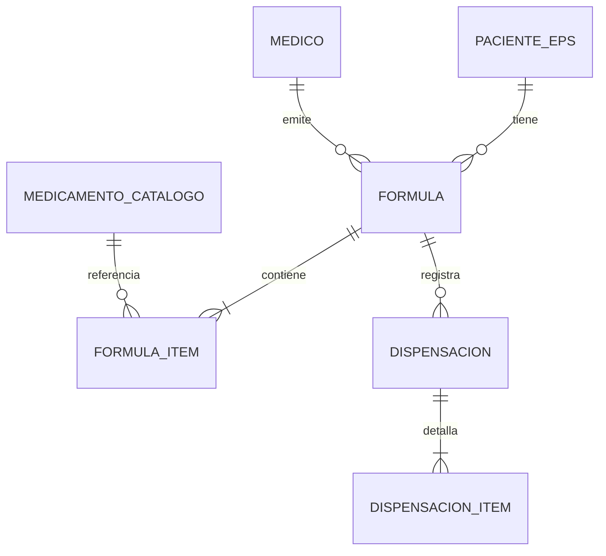
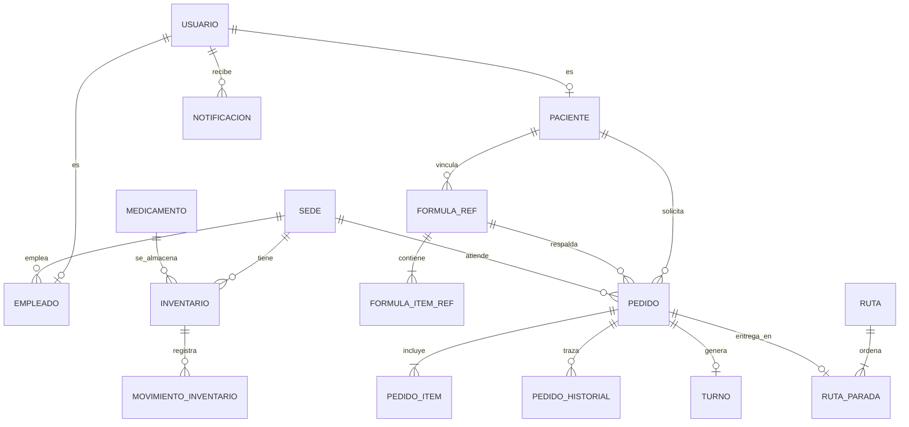
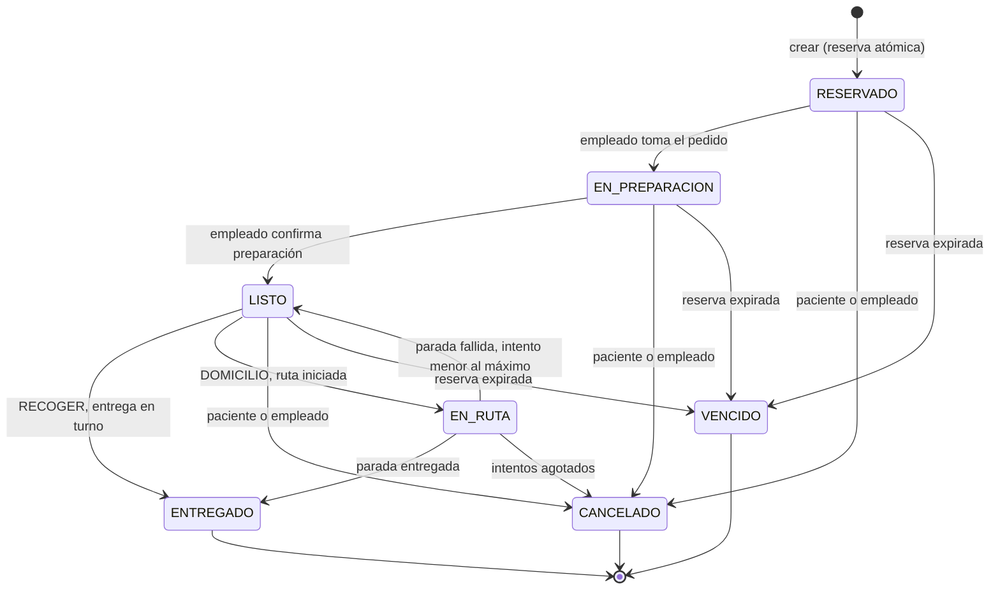
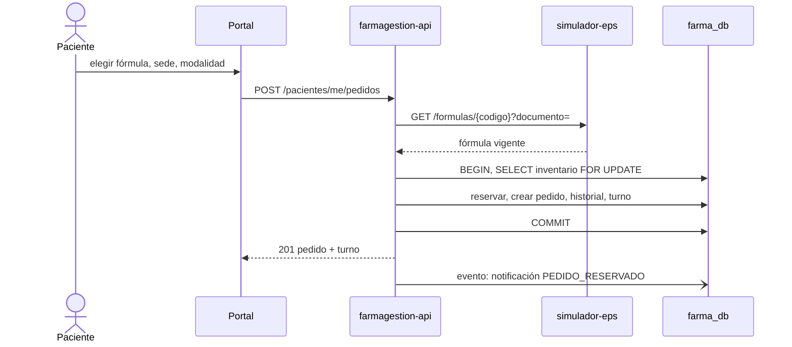
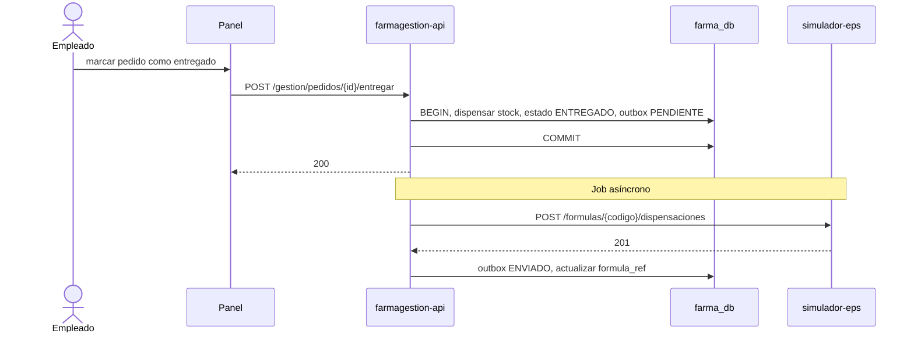

# 00 · Arquitectura y contratos — FarmaGestión (simulación)

> Documento base del Spec-Driven Development (SDD). Las specs `01`, `02` y `03` dependen de este archivo: lo que aquí se define (modelo de datos, contratos entre servicios, estados, convenciones) no se redefine en ellas.

| Campo | Valor |
|---|---|
| Proyecto | Sistema inteligente de gestión de inventario y turnos para operadores logísticos farmacéuticos |
| Organización simulada | FarmaGestión S.A.S. |
| Curso | Fundamentos de Sistemas de Información |
| Estado | Borrador v0.1 |

---

## 1. Propósito y relación con el portafolio

El proyecto simula, de punta a punta, el proceso que genera el problema diagnosticado: un paciente con una fórmula médica necesita reclamar sus medicamentos y hoy no puede saber si están disponibles antes de desplazarse.

| Proyecto del portafolio | Dónde vive en la simulación |
|---|---|
| P1. Sistema integrado de gestión y consulta de inventarios | Módulos `inventario` y `catalogo` de `farmagestion-api` (eje técnico) |
| P2. Plataforma digital de consulta de medicamentos y turnos | App 2 · Portal del paciente (`02-spec-portal-paciente.md`) |
| P3. Automatización de procesos internos | App 3 · Panel de empleados (`03-spec-panel-empleados.md`) y automatizaciones del backend |
| (andamiaje de la demo) | App 1 · Simulador EPS (`01-spec-simulador-eps.md`), fuera del portafolio |

## 2. Alcance y limitaciones globales

**Es:** una simulación funcional que demuestra el modelo de solución: inventario integrado por sede, reserva de medicamentos contra una fórmula, turnos informados, domicilios con ruta y automatización de estados.

**No es:** un reemplazo del sistema real de una operadora farmacéutica.

Limitaciones que aplican a las tres apps:

| # | Limitación |
|---|---|
| L1 | Todos los datos son sintéticos. No hay integración con ninguna EPS, IPS ni sistema de inventario real. |
| L2 | Las fórmulas son documentos simulados, sin validez clínica ni legal. Todo PDF lleva la marca "DOCUMENTO SIMULADO". |
| L3 | No se modelan lotes, fechas de vencimiento, cadena de frío ni medicamentos de control especial. El inventario se maneja por medicamento y sede. |
| L4 | No hay pagos, copagos, facturación ni autorización de la EPS. |
| L5 | Las notificaciones son dentro de la aplicación. Correo o SMS quedan como extensión (puerto `Notificador`). |
| L6 | Las rutas usan un heurístico simple sobre coordenadas, sin tráfico ni GPS en vivo. |
| L7 | Un solo operador (inquilino), sin alta disponibilidad, sin respaldos propios y sin pruebas de carga. |
| L8 | La verificación de identidad del paciente se limita a documento + código de fórmula. |
| L9 | Infraestructura gratuita: hay arranques en frío (ver §12). |
| L10 | En producción, las fórmulas son datos de salud sensibles y exigirían cumplimiento de la normativa de protección de datos personales. Aquí no se aplica porque no hay datos reales. |

## 3. Actores

| Actor | Descripción | App |
|---|---|---|
| Operador de demo | Persona que usa el simulador para crear pacientes y emitir fórmulas | 1 |
| Paciente | Usuario afiliado que reclama medicamentos | 2 |
| Farmacéutico / auxiliar | Empleado de una sede: inventario, preparación, entrega, turnos | 3 |
| Domiciliario | Empleado que ejecuta rutas de entrega | 3 |
| Administrador | Gestiona sedes, empleados, catálogo y parámetros | 3 |
| Sistema | Tareas programadas y eventos internos | backend |

## 4. Arquitectura

### 4.1 Componentes

| Componente | Tecnología | Despliegue | Base de datos |
|---|---|---|---|
| `simulador-eps` (App 1, UI + API) | Next.js (App Router) + TypeScript + Prisma | Vercel | `eps_db` |
| `portal-paciente` (App 2) | Next.js + TypeScript + Tailwind, PWA | Vercel | — |
| `panel-empleados` (App 3) | Next.js + TypeScript + Tailwind | Vercel | — |
| `farmagestion-api` | Spring Boot 4.x (4.1 o superior, última GA), Java 21, Maven, Spring Data JPA, Spring Security, Flyway, springdoc-openapi 3.x | Render (Docker) | `farma_db` |

Reglas de arquitectura:

1. **Dependencia en un solo sentido:** `farmagestion-api` llama al simulador. El simulador nunca llama al backend.
2. **Una base de datos por backend.** No hay tablas compartidas, llaves foráneas ni consultas entre `eps_db` y `farma_db`. La única relación es lógica, por `codigo` de medicamento y `codigo` de fórmula.
3. **Los dos frontends de FarmaGestión consumen la misma API** y se separan por rol y por namespace (`/pacientes/me/**`, `/gestion/**`).
4. **Monolito modular** en el backend. Cada módulo expone una interfaz y no accede a las tablas de otro módulo directamente.
5. **Contract-first en la integración:** el contrato del simulador vive en `contracts/eps-simulador.openapi.yaml` y la API del backend publica su OpenAPI en `/v3/api-docs`.

### 4.2 Módulos del backend

| Módulo | Responsabilidad |
|---|---|
| `auth` | Registro de pacientes, login, JWT, roles |
| `catalogo` | Medicamentos y sedes; consulta pública de disponibilidad |
| `inventario` | Stock por sede, reservas, kárdex, alertas de stock mínimo |
| `formulas` | Adaptador (anti-corruption layer) hacia el simulador; copia local `formula_ref` |
| `pedidos` | Pedido, máquina de estados, historial |
| `turnos` | Franjas, turnos y cola por sede |
| `domicilios` | Rutas y paradas, heurístico de orden |
| `notificaciones` | Puerto `Notificador` y adaptador in-app |
| `integracion` | Outbox y reintentos hacia el simulador |
| `reportes` | Consultas agregadas |

Comunicación entre módulos: llamadas a interfaces públicas y eventos de dominio de Spring (`ApplicationEventPublisher`) para efectos secundarios (notificaciones, outbox).

### 4.3 Estructura del repositorio (monorepo)

```
farmagestion/
├── docs/
│   └── specs/                  # estos 4 archivos .md
├── contracts/
│   └── eps-simulador.openapi.yaml
├── data/seed/
│   └── catalogo-medicamentos.json   # catálogo compartido (cada servicio carga su copia)
├── apps/
│   ├── simulador-eps/          # App 1 (Next.js)
│   ├── portal-paciente/        # App 2 (Next.js)
│   └── panel-empleados/        # App 3 (Next.js)
├── services/
│   └── farmagestion-api/       # Spring Boot (Dockerfile incluido)
└── README.md
```

### 4.4 Despliegue

| Servicio | Plataforma | Directorio raíz | Variables de entorno principales |
|---|---|---|---|
| simulador-eps | Vercel | `apps/simulador-eps` | `DATABASE_URL` (Neon, cadena pooled, para la app), `DIRECT_URL` (Neon, cadena directa, solo para migraciones desde local), `FARMA_SERVICE_API_KEY`, `DEMO_ADMIN_PASSWORD`, `SESSION_SECRET` |
| portal-paciente | Vercel | `apps/portal-paciente` | `NEXT_PUBLIC_API_URL` |
| panel-empleados | Vercel | `apps/panel-empleados` | `NEXT_PUBLIC_API_URL` |
| farmagestion-api | Render (Docker) | `services/farmagestion-api` | `SPRING_DATASOURCE_URL`, `SPRING_DATASOURCE_USERNAME`, `SPRING_DATASOURCE_PASSWORD`, `JWT_SECRET`, `EPS_SIMULADOR_URL`, `EPS_SIMULADOR_API_KEY`, `CORS_ALLOWED_ORIGINS` |
| Postgres | Neon | un proyecto, dos bases: `eps_db`, `farma_db` | — |

Notas de configuración del backend con Neon:

- Usar la cadena **directa** (host sin `-pooler`) de Neon: HikariCP ya hace de pool y Flyway necesita conexión directa para migrar.
- JDBC recibe host, base, usuario y contraseña por separado (`SPRING_DATASOURCE_*`); no se pega la cadena `postgresql://` de Neon tal cual.
- `sslmode=require` en la URL JDBC.
- Pool pequeño: `spring.datasource.hikari.maximum-pool-size=5` y `connection-timeout=30000`, porque la primera conexión tras la pausa de Neon tarda más.
- Migraciones con Flyway al arrancar (`db/migration/V1__...sql`).

## 5. Convenciones transversales

| Tema | Decisión |
|---|---|
| Identificadores | `uuid` (`gen_random_uuid()`) como PK. Los códigos legibles (`PED-…`, `FRM-…`) son columnas aparte con restricción única |
| Tiempo | Columnas `timestamptz` guardadas en UTC. La lógica de negocio usa la zona `America/Bogota` |
| Nombres en BD | `snake_case` en español |
| Nombres en JSON | `camelCase` en español |
| Versionado de API | Prefijo `/api/v1` |
| Errores | `application/problem+json` (RFC 7807) con campos `type`, `title`, `status`, `detail` y `code` (código de negocio estable) |
| Paginación | `?page=0&size=20`; respuesta con `content`, `page`, `size`, `totalElements` |
| Autenticación de usuarios | JWT (HS256), expiración 2 h, claims `sub`, `rol`, `sedeId` (empleados). Contraseñas con BCrypt. Sin refresh token (limitación aceptada) |
| Autenticación entre servicios | Cabecera `X-API-Key` |
| CORS | Solo los orígenes de los dos frontends de FarmaGestión |
| Salud | `GET /api/v1/health` sin autenticación en ambos backends (sirve para despertar el servicio) |
| Idempotencia | Cabecera `Idempotency-Key` en operaciones de escritura entre servicios |

## 6. Modelo de datos

### 6.1 `eps_db` (propiedad del simulador)

| Tabla | Columnas principales |
|---|---|
| `paciente_eps` | `id`, `tipo_documento`, `documento`, `nombres`, `apellidos`, `fecha_nacimiento`, `eps`, `telefono`, `created_at`. Único `(tipo_documento, documento)` |
| `medico` | `id`, `nombre`, `registro` (ficticio), `especialidad` |
| `medicamento_catalogo` | `codigo` (PK), `nombre`, `principio_activo`, `presentacion` |
| `formula` | `id`, `codigo` (único), `paciente_id`, `medico_id`, `fecha_emision`, `fecha_vencimiento`, `estado`, `observaciones`, `created_at` |
| `formula_item` | `id`, `formula_id`, `medicamento_codigo`, `dosis`, `frecuencia`, `duracion_dias`, `cantidad_autorizada`, `cantidad_dispensada`. Check `0 <= cantidad_dispensada <= cantidad_autorizada` |
| `dispensacion` | `id`, `formula_id`, `pedido_ref`, `sede_codigo`, `idempotency_key` (único), `fecha` |
| `dispensacion_item` | `dispensacion_id`, `medicamento_codigo`, `cantidad` |



### 6.2 `farma_db` (propiedad de `farmagestion-api`)

**Identidad y sedes**

| Tabla | Columnas principales |
|---|---|
| `usuario` | `id`, `email` (único), `password_hash`, `rol` (`PACIENTE`/`EMPLEADO`/`ADMIN`), `activo`, `created_at` |
| `paciente` | `usuario_id` (PK, FK), `tipo_documento`, `documento`, `nombres`, `apellidos`, `telefono`. Único `(tipo_documento, documento)` |
| `empleado` | `usuario_id` (PK, FK), `sede_id` (FK, nulo para `ADMIN`), `cargo` (`FARMACEUTICO`/`AUXILIAR`/`DOMICILIARIO`), `nombres`, `apellidos` |
| `sede` | `id`, `codigo` (único), `nombre`, `direccion`, `latitud`, `longitud`, `hora_apertura`, `hora_cierre`, `activa` |

**Catálogo e inventario**

| Tabla | Columnas principales |
|---|---|
| `medicamento` | `id`, `codigo` (único), `nombre`, `principio_activo`, `presentacion`, `activo` |
| `inventario` | `id`, `sede_id`, `medicamento_id`, `cantidad_fisica`, `cantidad_reservada`, `stock_minimo`, `version`. Único `(sede_id, medicamento_id)`. Check `0 <= cantidad_reservada <= cantidad_fisica` |
| `movimiento_inventario` | `id`, `sede_id`, `medicamento_id`, `tipo`, `cantidad`, `saldo_fisico`, `referencia_tipo`, `referencia_id`, `usuario_id`, `motivo`, `created_at` |

Definiciones: `disponible = cantidad_fisica − cantidad_reservada`. Tipos de movimiento: `ENTRADA`, `AJUSTE_POS`, `AJUSTE_NEG`, `RESERVA`, `LIBERACION`, `DISPENSACION`, `TRASLADO_SALIDA`, `TRASLADO_ENTRADA`.

**Fórmulas, pedidos y entregas**

| Tabla | Columnas principales |
|---|---|
| `formula_ref` | `id`, `codigo_externo` (único), `paciente_id`, `estado_externo`, `fecha_emision`, `fecha_vencimiento`, `sincronizada_en` |
| `formula_item_ref` | `id`, `formula_ref_id`, `medicamento_id`, `cantidad_autorizada`, `cantidad_dispensada` |
| `pedido` | `id`, `codigo` (único), `paciente_id`, `formula_ref_id`, `sede_id`, `modalidad` (`RECOGER`/`DOMICILIO`), `estado`, `es_parcial`, `direccion_entrega`, `latitud_entrega`, `longitud_entrega`, `intentos_entrega`, `expira_en`, `asignado_a` (empleado), `created_at`, `updated_at`, `listo_en`, `entregado_en` |
| `pedido_item` | `id`, `pedido_id`, `medicamento_id`, `cantidad_solicitada`, `cantidad_reservada`, `cantidad_entregada`, `estado_item` (`COMPLETO`/`PARCIAL`/`AGOTADO`) |
| `pedido_historial` | `id`, `pedido_id`, `estado_anterior`, `estado_nuevo`, `usuario_id`, `nota`, `created_at` |
| `turno` | `id`, `pedido_id` (único), `sede_id`, `fecha`, `franja_inicio`, `numero`, `codigo`, `estado`, `llamado_en`, `atendido_en`. Único `(sede_id, fecha, numero)` |
| `ruta` | `id`, `sede_id`, `domiciliario_id`, `fecha`, `estado`, `distancia_km`, `created_at` |
| `ruta_parada` | `id`, `ruta_id`, `pedido_id`, `orden`, `estado`, `distancia_km_desde_anterior` |

**Soporte**

| Tabla | Columnas principales |
|---|---|
| `notificacion` | `id`, `usuario_id`, `tipo`, `titulo`, `mensaje`, `referencia_tipo`, `referencia_id`, `leida`, `created_at` |
| `evento_integracion` | `id`, `tipo`, `payload` (jsonb), `estado` (`PENDIENTE`/`ENVIADO`/`ERROR`), `intentos`, `ultimo_error`, `idempotency_key` (único), `created_at`, `enviado_en` |
| `parametro` | `clave` (PK), `valor`, `descripcion` |



### 6.3 Parámetros (`parametro`)

| Clave | Valor por defecto | Uso |
|---|---|---|
| `reserva.ttl_domicilio_horas` | 24 | Vencimiento de la reserva en pedidos a domicilio |
| `reserva.gracia_turno_min` | 30 | Minutos tras el fin de la franja antes de vencer una reserva de turno |
| `turno.franja_min` | 30 | Duración de la franja |
| `turno.capacidad_franja` | 6 | Turnos máximos por franja y sede |
| `turno.dias_adelante` | 1 | Días hacia adelante en que se puede agendar |
| `domicilio.max_paradas` | 8 | Paradas máximas por ruta |
| `domicilio.max_intentos` | 2 | Intentos de entrega antes de cancelar |
| `inventario.stock_minimo_default` | 10 | Mínimo inicial al crear un registro de inventario |

## 7. Estados

### 7.1 Pedido



- Un pedido parcial no es un estado: es el atributo `es_parcial` (algún `pedido_item` con `estado_item != COMPLETO`).
- `CANCELADO` y `VENCIDO` liberan la reserva (`LIBERACION`).
- `ENTREGADO` convierte reserva en salida física (`DISPENSACION`) y encola el evento hacia el simulador.

### 7.2 Turno

`EN_ESPERA → LLAMADO → ATENDIDO`, y `EN_ESPERA/LLAMADO → VENCIDO` (no se presentó) o `CANCELADO` (pedido cancelado).

### 7.3 Fórmula (propiedad del simulador)

`EMITIDA → PARCIALMENTE_DISPENSADA → DISPENSADA`. Además `VENCIDA` (por fecha) y `ANULADA` (manual).

### 7.4 Ruta y parada

Ruta: `PLANEADA → EN_CURSO → COMPLETADA`. Parada: `PENDIENTE → ENTREGADA` o `FALLIDA`.

## 8. Reglas de negocio transversales

**RN-01 · Reserva atómica.** Crear un pedido bloquea las filas de `inventario` de los medicamentos involucrados con `SELECT … FOR UPDATE`, ordenadas por `medicamento_id` para evitar interbloqueos. Para cada ítem se reserva `min(solicitada, disponible)`. La operación es transaccional.

**RN-02 · Pedido parcial.** Si algún ítem queda en `PARCIAL` o `AGOTADO` y la solicitud trae `aceptaParcial = false`, no se crea el pedido y se responde `409 STOCK_INSUFICIENTE` con el detalle por ítem. Si `aceptaParcial = true`, se crea con `es_parcial = true`. Un pedido con todos los ítems `AGOTADO` nunca se crea.

**RN-03 · Cantidad pendiente de la fórmula.** Por cada ítem de fórmula: `pendiente = cantidad_autorizada − cantidad_dispensada − Σ cantidad_reservada de pedidos activos`. Un pedido no puede solicitar más que el pendiente. Pedidos activos: `RESERVADO`, `EN_PREPARACION`, `LISTO`, `EN_RUTA`.

**RN-04 · Fórmula vigente.** Solo se crean pedidos sobre fórmulas con `estado_externo` en `EMITIDA` o `PARCIALMENTE_DISPENSADA` y `fecha_vencimiento >= hoy`. Antes de crear el pedido se refresca la copia local consultando al simulador. Si el simulador no responde, la creación falla con `503 SIMULADOR_NO_DISPONIBLE`.

**RN-05 · Vencimiento de reserva.** `expira_en` = fin de la franja + `reserva.gracia_turno_min` para `RECOGER`; creación + `reserva.ttl_domicilio_horas` para `DOMICILIO`. Pasado ese instante, el pedido sin entregar pasa a `VENCIDO` y libera stock. El vencimiento se evalúa con un job y también de forma perezosa al leer o modificar el pedido.

**RN-06 · Dispensación e integración.** Al pasar a `ENTREGADO`, en la misma transacción se registra la `DISPENSACION` en inventario y se inserta un `evento_integracion` (`DISPENSACION_FORMULA`) con `idempotency_key = pedido.id`. Un job envía los eventos `PENDIENTE` al simulador y reintenta con espera creciente hasta 10 intentos. La entrega al paciente nunca depende de que el simulador responda.

**RN-07 · Stock mínimo.** Cuando `disponible` cae a `stock_minimo` o menos tras un movimiento, se notifica a los empleados de la sede (una vez por cruce, sin repetir mientras siga bajo el mínimo).

**RN-08 · Trazabilidad.** Todo cambio de estado de pedido escribe `pedido_historial`. Todo cambio de stock escribe `movimiento_inventario`.

**RN-09 · Alcance por sede.** Un `EMPLEADO` solo ve y opera datos de su `sedeId`. El `ADMIN` ve todas las sedes.

**RN-10 · Disponibilidad pública.** La consulta pública devuelve niveles, no cantidades exactas: `DISPONIBLE` (`disponible > stock_minimo`), `POCAS_UNIDADES` (`0 < disponible <= stock_minimo`), `AGOTADO` (`disponible = 0`).

## 9. Contrato de integración: backend → simulador

Base: `{EPS_SIMULADOR_URL}/api/v1`. Autenticación: `X-API-Key`. Contenido: `application/json`.

### 9.1 Consultar fórmula

`GET /formulas/{codigo}?documento={documento}`

Respuesta `200`:

```json
{
  "codigo": "FRM-2026-000123",
  "estado": "EMITIDA",
  "fechaEmision": "2026-11-20",
  "fechaVencimiento": "2026-12-20",
  "observaciones": "Control en 30 días",
  "paciente": {
    "tipoDocumento": "CC",
    "documento": "1000000001",
    "nombres": "Ana María",
    "apellidos": "Ríos Gómez"
  },
  "medico": { "nombre": "Dr. Carlos Mejía" },
  "items": [
    {
      "medicamentoCodigo": "MED-0007",
      "medicamentoNombre": "Losartán 50 mg tableta",
      "dosis": "1 tableta",
      "frecuencia": "cada 12 horas",
      "duracionDias": 30,
      "cantidadAutorizada": 60,
      "cantidadDispensada": 0
    }
  ]
}
```

Errores: `404 FORMULA_NO_ENCONTRADA` (también cuando el documento no coincide, para no revelar la existencia de la fórmula), `401` si falta o es inválida la API key.

### 9.2 Descargar PDF

`GET /formulas/{codigo}/pdf?documento={documento}` → `200 application/pdf`. Mismos errores que 9.1.

### 9.3 Registrar dispensación

`POST /formulas/{codigo}/dispensaciones`

Cabeceras: `Idempotency-Key: {uuid}`.

```json
{
  "pedidoRef": "9d2c0b7e-6a53-4f0e-9a0c-2f8f3d2a1b11",
  "sedeCodigo": "SEDE-CENTRO",
  "fecha": "2026-11-21T15:42:00Z",
  "items": [
    { "medicamentoCodigo": "MED-0007", "cantidad": 60 }
  ]
}
```

| Código | Significado |
|---|---|
| `201` | Dispensación registrada. Devuelve la fórmula actualizada (mismo esquema que 9.1) |
| `200` | Repetición con la misma `Idempotency-Key`: devuelve el resultado original sin duplicar |
| `404 FORMULA_NO_ENCONTRADA` | Código de fórmula inexistente |
| `409 FORMULA_NO_DISPENSABLE` | Fórmula `VENCIDA` o `ANULADA` |
| `409 CANTIDAD_EXCEDE_AUTORIZADA` | `cantidadDispensada + cantidad > cantidadAutorizada` |
| `422 MEDICAMENTO_NO_EN_FORMULA` | El medicamento no pertenece a la fórmula |

El backend trata `409` y `422` como errores definitivos (estado `ERROR` en el outbox, sin reintento, con alerta para el administrador) y los demás fallos como reintentables.

### 9.4 Salud

`GET /health` → `200 {"status":"ok"}` sin autenticación.

## 10. Flujos principales

### 10.1 Crear pedido con reserva y turno



### 10.2 Entrega y dispensación



## 11. Automatizaciones (tareas programadas)

Todas las tareas son idempotentes y se basan en marcas de tiempo, no en que se hayan ejecutado en un momento exacto.

| Tarea | Frecuencia | Acción |
|---|---|---|
| `ExpirarReservas` | cada minuto | Pedidos activos con `expira_en` vencido → `VENCIDO` + liberación |
| `VencerTurnos` | cada 5 min | Turnos `EN_ESPERA` con franja vencida más gracia → `VENCIDO` |
| `ReintentarOutbox` | cada minuto | Envía eventos `PENDIENTE` al simulador con espera creciente |
| `SincronizarFormulas` | al leer y cada hora | Refresca `formula_ref` de pedidos activos |

## 12. Riesgos y decisiones abiertas

| Riesgo | Mitigación |
|---|---|
| Render gratuito apaga el servicio tras 15 min sin tráfico (≈1 min de arranque) y las tareas programadas no corren mientras está apagado | Tareas idempotentes con "puesta al día" al arrancar; evaluación perezosa de vencimientos; lista de verificación pre-demo que llama a `/health` de ambos servicios |
| Neon gratuito pausa el cómputo tras 5 min de inactividad | Pool pequeño y `connection-timeout` alto; primera consulta lenta aceptada |
| Dos servicios en frío encadenados (backend → simulador) suman tiempo de arranque | El simulador corre en Vercel (serverless), sin arranque largo |
| Alcance excesivo para el tiempo disponible | Plan por hitos (§13); domicilios, reportes y traslados son fase 2 |

Decisiones abiertas para confirmar con el equipo:

1. Quién desarrolla cada app (el backend es el camino crítico).
2. Si se incluye correo como segundo canal de notificación.
3. Si los traslados entre sedes entran en el alcance (la estrategia DA2 los menciona).

## 13. Plan de construcción

| Hito | Contenido | Hecho cuando |
|---|---|---|
| H0 · Esqueleto | Monorepo, migraciones iniciales, los 4 servicios desplegados con `/health`, seed de catálogo | Las 4 URLs responden y el backend conecta a Neon |
| H1 · Corte vertical | Emitir fórmula (App 1) → paciente la vincula y ve disponibilidad (App 2) → crea pedido RECOGER con reserva y turno → empleado lo prepara y entrega (App 3) → el simulador registra la dispensación | El flujo completo corre en producción con datos semilla |
| H2 · Completar | Inventario completo con kárdex, cancelación, vencimientos, notificaciones, descarga de PDF, cola de turnos | Criterios de aceptación de las 3 specs cumplidos |
| H3 · Fase 2 | Domicilios con rutas, reportes, traslados, correo | Según tiempo |

## 14. Datos semilla

- Catálogo: 30 medicamentos genéricos con códigos `MED-0001…MED-0030` (`data/seed/catalogo-medicamentos.json`).
- 3 sedes ficticias: `SEDE-CENTRO`, `SEDE-BELLO`, `SEDE-ITAGUI`, con coordenadas aproximadas de sus municipios.
- Inventario inicial aleatorio por sede, con algunos medicamentos en cero o bajo el mínimo para demostrar los casos de faltante.
- 1 administrador, 2 empleados y 1 domiciliario por sede, y 5 pacientes con documentos ficticios. Contraseña de demostración definida en el README del repositorio.
